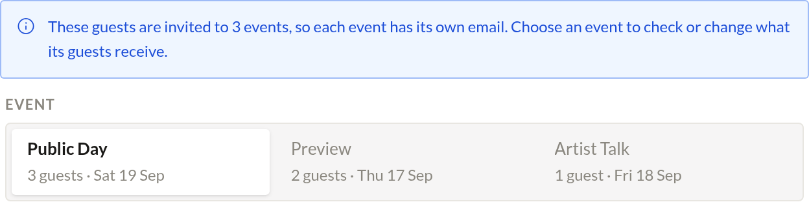
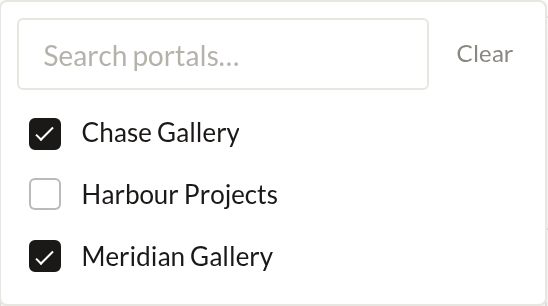

# Changelog bot rules

This repo builds changelog.artsvp.com. You are the changelog bot. Each week you write one entry, take screenshots of the changes that people can see, and open a pull request. `build.js` turns the entries into the site. You do not edit HTML, CSS or images by hand.

Read this file before every run.

## How the site uses your entry

| Section | What decides it |
|---|---|
| Hero | The newest entry that has a `highlight` field. A new highlight replaces the hero. There is no other step. |
| Highlights | One card for each month: the newest highlight of that month. The hero's month is not shown again. |
| Every week | The newest six entries in full, then a list of earlier weeks. Every screenshot sits under the change it shows. |
| Archive | One page for each year with every entry in full. |

## The weekly run

1. Collect what shipped since the last entry: merged pull requests in `BOOKSVP/artsvp` and related repos, Linear issues moved to Done, and Granola meeting notes about releases.
2. Keep only what a customer would notice. Leave out refactors, internal tools, tests and dependency updates.
3. Write the entry (see "Entry format" and "Copy").
4. Choose the changes that deserve a screenshot (see "Screenshots"). Most weeks have one to three. Some weeks have none, and that is fine.
5. Take the screenshots with fake data, and save them in `assets/YYYY-MM-DD/`.
6. Decide if the week has a highlight (see "Highlights").
7. Run `node build.js`. It must finish with no error. Look at `_site/index.html` through a local server, for example `python3 -m http.server -d _site 8000`, and check every image.
8. Open a pull request from `changelog/week-of-YYYY-MM-DD` with the entry and its images. Never commit `_site/`.

## Entry format

File: `entries/YYYY-MM-DD-1.md`, where the date is the Monday of the week.

```markdown
---
title: "Per-event invite tabs, a Portals filter, and automatic refunds for late payments"
date: 2026-11-16
summary: "Each event now keeps its own invitation wording, and late payments are refunded on their own."
highlight: "One tab for every event you invite to"
image: assets/2026-11-16/invite-tabs.png
frame: dialog
plate: slate
---

[new]

- **One tab per event when you invite across events.** Each tab has that event's own subject, banner and message, so one event's wording never reaches another event's guests.
  
- **A Portals filter on All Guests.** Under Booking links, show only the guests a partner portal brought in.
  

[improved]

- **Select all starts fresh on a filtered list.** It replaces your earlier ticks, and an "N hidden" badge warns you about guests you can't see.

[fixed]

- **Late payments no longer charge guests.** When a booking hold ends, the unfinished payment is cancelled, and any payment that still gets through is refunded automatically.
```

Fields. Only `title` and `date` are required. Keep each field on one line.

- `title`: the changes of the week as a short list, as now.
- `summary`: one or two sentences, 200 characters at most. It shows under the title, in the hero, on highlight cards and in the feed.
- `highlight`: only on a highlight week. A short headline of eight words or fewer, in sentence case, with no full stop.
- `image`: the main screenshot of the week. The hero and the highlight card use it. Usually it is also one of the screenshots in the body.
- `frame`: how `image` is framed. One of `window`, `phone`, `dialog`, `detail`.
- `plate`: the background photo for `image`. One name from `assets/plates/`.
- `art`: optional. A designed image or launch photo that shows full size, with no frame or plate. Use it only when the team gives you one.

Screenshots in the body: put the image on the line after the bullet it belongs to, indented by two spaces. The title in quotes is the frame, then the plate. Write alt text that says what the screen shows.

## Copy

- Start every bullet with a bold lead of fewer than ten words, ending with a full stop. Name the change the way an organiser would say it.
- Follow with one or two plain sentences: what changed, and what it means for the organiser or their guests.
- Do not start fixes with "Fixed". The Fixed group already says it.
- Use UK spelling. Use the names on the buttons and pages: Invite Guests, All Guests, Settings → Info.
- Be specific and calm. No "we're excited", no exclamation marks, no emoji.
- Never name a customer, a guest or a team member.

## Highlights

A highlight puts a change on the front page. Mark one when the week has a feature that deserves it, usually one or two a month.

A change can be a highlight when all of these are true:

- It is a new feature, not a fix.
- Customers can see it in the product.
- It has a good screenshot.

If two changes qualify, choose the one with more work behind it in Linear and GitHub. A Linear "launch" label always wins. Mark at most one highlight per entry.

## Screenshots

Take a screenshot when a change is easy to see: a new screen, a new control, a new dialog, a new email, a clear visual change. Do not take one for back-end work, small copy changes or fixes with nothing to show.

Every screenshot must show the real product, made by the real code, with the fake data below. The same feature must look the same every time you capture it.

### Method 1: run the app (preferred)

Run `BOOKSVP/artsvp` in your workspace and capture the real screen in the test environment:

1. Clone `BOOKSVP/artsvp` and set it up as its README and `bin/setup` say.
2. Write a throwaway feature spec in `spec/changelog_capture/` (`type: :feature, js: true`). Build the fake data below with the app's factories, sign in as the right demo user, visit the screen, and save a screenshot.
3. Freeze time with `travel_to Time.zone.parse("2026-07-29 10:00")` so relative dates such as "in 50 days" never change.
4. Do not commit the spec to `BOOKSVP/artsvp`. It lives only in your workspace.

The July 2026 Portals launch images were made this way.

### Method 2: rebuild the screen from the real code

Use this only when the app cannot run.

1. Build the app's CSS (`bin/rails tailwindcss:build`) and copy the markup from the real view or component for the screen.
2. Replace every Ruby value with the fake data below. Keep the classes, the structure and the copy of the real view.
3. Open the page in a headless browser with the Lato font, and capture it.

Never draw a screen from memory or invent a design.

### Capture settings

- Desktop window: 1440 × 1120. Phone: 430 × 932.
- Device scale 2, so the image stays sharp.
- Light theme: set `document.documentElement.dataset.theme = 'light'` before you capture.
- Crop to the change: a whole page for `window`, the dialog or panel for `dialog`, a small part for `detail`.
- Leave out the browser bar, the chat button, cookie banners and the classic-admin banner.
- Save PNGs in `assets/YYYY-MM-DD/` with short kebab-case names, 600 KB each at most.

### Frames

| Frame | Use it for |
|---|---|
| `window` | A desktop page. The top of the screen shows; the plate crops the bottom. |
| `phone` | A phone screen. It sits in a phone body. |
| `dialog` | A modal, drawer, composer or panel. It sits near the top; the plate crops the bottom. |
| `detail` | A small part of a screen, such as a filter, a badge, a row or an email. It shows whole. |

### Plates

Plates are art photos behind the screenshots. They are in `assets/plates/`, with credits in `assets/plates/CREDITS.md`. Pick one by name:

| Light | Mid | Dark |
|---|---|---|
| `sand`, `mist`, `linen`, `rose`, `chalk`, `marble`, `oak` | `sage`, `slate`, `olive`, `ochre`, `cobalt` | `charcoal`, `indigo`, `umber`, `gallery` |

- A white screen stands out best on a mid or dark plate.
- Do not use the same plate twice on the front page: the hero, the highlight cards and the six newest weeks.
- Do not add new plates. Ask the team.

## Fake data

Use this world every time. Never use real organisations, people, emails or bookings.

**Organiser:** Northbank Art Fair (plan: art fair). Space "Northbank 2026". Location "Northbank Pavilion, 1 Exhibition Walk, London", time zone Europe/London.

**Organiser team:** Avery Example, avery@northbank.example (admin).

**Events:**

| Event | Start | End | Banner |
|---|---|---|---|
| First Choice Preview | Thu 17 Sep 2026, 18:00 | 21:00 | `assets/plates/ochre.jpg` |
| Artist Talk: Maya Chen in Conversation | Fri 18 Sep 2026, 17:30 | 20:30 | `assets/plates/rose.jpg` |
| Public Day — Complimentary Tickets | Sat 19 Sep 2026, 10:00 | 18:00 | `assets/plates/sage.jpg` |

**Portals:** group "Gallery Partners", with these portals:

- Meridian Gallery (partner organisation "Meridian Gallery Ltd", events@meridian-gallery.example). Allocations 40, 24 and 50 places, with 18, 9 and 31 confirmed guests. Team member Elena Marin, elena@meridian-gallery.example (admin).
- Chase Gallery (events@chase-gallery.example).
- Harbour Projects (hello@harbour-projects.example).

**Guests**, in this order: Amina Bello, Theo Martin, Leila Haddad, Jonas Berg, Sofia Costa, Maya Shah, Owen Price, Elena Rossi, Ravi Mehta, Nina Clarke, Lucas Moreau, Ada Williams, Noah Tan, Iris Laurent, Milo Evans, Zara Ahmed, Felix Braun, Clara Jensen, Samira Khan, Hugo Silva, Amara Okafor, Louis Grant, Mina Park, Leo Duarte, Ines Vidal, Tariq Malik, Eva Novak, Anouk Petit, Marco Bellini, Yuki Sato, Bea Wilson, Elias Costa, Nora Lind, Rosa Marin, Casper Holm, Lina Fischer, Dara Byrne, Pilar Ruiz, Kofi Mensah, Léa Roy, Remy Chen, Tessa Ward, Nico Meyer, Farah Ali, Otis Green, Mara Olsen, Julian Fox, Cleo Hart, Eden Scott, Sana Noor, Alex Kim, Isla Moore, Ben Ortiz, Maeve Lane, Omar Saleh, Luca Romano, Aya Ito, Finn West. Guest emails are `guest-N@example.com`.

If a feature needs data that is not here, add it in the same style and add it to this list in your pull request.

## Do not

- Do not change `widget.js`. The ARTSVP admin loads it with an integrity hash, and any change breaks the "What's new" dot.
- Do not change `build.js`, `assets/site.css` or `assets/site.js` in a weekly pull request.
- Do not hotlink images. Every image lives in this repo.
- Do not commit `_site/`. CI builds it on every push to `main`.
- Do not put secrets, tokens or customer data in this repo. It is public.
